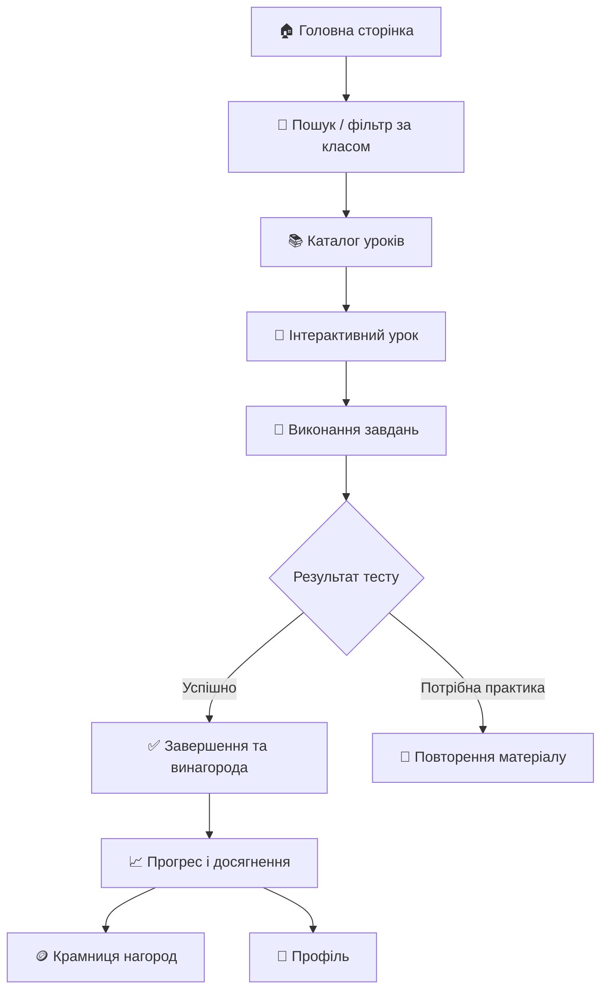

<div align="center">

# 🎓 Навчальна лабораторія

### Навчайся. Експериментуй. Відкривай нове.

**Інтерактивний освітній вебзастосунок для школярів, який поєднує навчальні уроки, практику, гейміфікацію та персональний прогрес.**

[Можливості](#-можливості) · [Швидкий старт](#-швидкий-старт) · [Навчальний каталог](#-навчальний-каталог) · [Архітектура](#-архітектура) · [Firebase](#-налаштування-firebase) · [Розгортання](#-розгортання)


</div>

---

## 🧭 Зміст

- [Про проєкт](#-про-проєкт)
- [Можливості](#-можливості)
- [Навчальний каталог](#-навчальний-каталог)
- [Як працює навчання](#-як-працює-навчання)
- [Технологічний стек](#-технологічний-стек)
- [Архітектура та структура](#-архітектура-та-структура)
- [Швидкий старт](#-швидкий-старт)
- [Налаштування Firebase](#-налаштування-firebase)
- [Розгортання](#-розгортання)
- [Дані та безпека](#-дані-та-безпека)
- [Перевірка перед публікацією](#-перевірка-перед-публікацією)
- [Відомі технічні нюанси](#-відомі-технічні-нюанси)
- [Подальший розвиток](#-подальший-розвиток)
- [Ліцензія](#-ліцензія)

## 🌱 Про проєкт

**«Навчальна лабораторія»** — вебзастосунок, що створює єдиний цифровий простір для вивчення шкільних предметів. Інтерфейс організовано навколо каталогу уроків, предметних сторінок, особистого профілю, досягнень і кабінету вчителя.

Проєкт реалізований як багатосторінковий вебсайт на HTML, CSS і JavaScript без обов’язкового етапу frontend-збирання. Для авторизації та хмарного збереження передбачена інтеграція з Firebase. Основний навчальний каталог зберігається у `data/lessons.json`, а інтерактивний вміст кожного уроку — у власній папці.

> 🎯 **Мета:** зробити навчання зрозумілим, практичним і мотивувальним — щоб учень не лише читав матеріал, а й виконував завдання, відстежував свій поступ і відкривав нові цілі.

## ✨ Можливості

| Можливість | Що вона дає |
|---|---|
| 📚 **Каталог уроків** | Перегляд навчальних матеріалів, пошук за назвою та фільтрація за класом. |
| ➗ **Предметні напрями** | Окремі сторінки математики, інформатики та STEM. |
| 🧩 **Інтерактивні уроки** | Навчальні сторінки з власною розміткою, стилями та JavaScript-логікою. |
| 🎮 **Гейміфікація** | Внутрішня валюта «комп’юшки», досягнення, нагороди та крамниця. |
| 📈 **Прогрес навчання** | Облік завершених уроків, результатів спроб і найкращих результатів, якщо їх підтримує конкретний урок. |
| 👤 **Профіль учня** | Профіль і дані навчального прогресу. |
| ☁️ **Хмарна синхронізація** | Firebase Authentication і Cloud Firestore для авторизованих користувачів за належної конфігурації. |
| 🧑‍🏫 **Кабінет учителя** | Перегляд профілів учнів та їхніх навчальних показників; експорт таблиці в CSV. |
| 🏅 **Досягнення й нагороди** | Мотиваційні цілі за проходження уроків і накопичення валюти. |
| 🌓 **Світла й темна теми** | Перемикання оформлення інтерфейсу. |
| 📱 **Адаптивний інтерфейс** | Стилі для зручного користування на різних розмірах екрана. |
| ❔ **Довідкові сторінки** | Розділи «Часті питання» та «Про застосунок». |

> **Примітка щодо функцій:** набір доступних інтерактивностей може відрізнятися залежно від конкретного уроку. Хмарна синхронізація, авторизація та кабінет учителя потребують робочого проєкту Firebase і коректних правил доступу.

## 📚 Навчальний каталог

У поточному `data/lessons.json` описано **12 уроків** для 5–6 класів. Це кількість записів у каталозі, а не твердження про повне покриття всіх класів 1–11: фільтр інтерфейсу передбачає класи 1–11, але фактичні уроки мають власні значення `grades`.

<details>
<summary><strong>➗ Математика — 6 уроків</strong></summary>

- **Точка, пряма та промінь** — базові геометричні поняття.
- **Координатний промінь** — розміщення чисел на промені.
- **Трикутник** — знайомство з трикутниками.
- **Кути та їх вимірювання** — геометричні кути та їх величини.
- **Прямокутник. Квадрат** — властивості геометричних фігур.
- **Відсотки** — розуміння та застосування відсотків.

</details>

<details>
<summary><strong>💻 Інформатика — 3 уроки</strong></summary>

- **Складові комп’ютера** — компоненти комп’ютерної системи.
- **Комп’ютерні презентації** — створення та використання презентацій.
- **Алгоритми в Scratch** — початкові алгоритмічні поняття.

</details>

<details>
<summary><strong>⚙️ STEM — 3 уроки</strong></summary>

- **Система автоматичного поливу рослин** — приклад інженерного рішення.
- **Проєктування та тестування планерів** — проєктування та перевірка моделей.
- **Інженерне проектування в Tinkercad** — основи цифрового інженерного проєктування.

</details>

### Як додається урок

1. Створіть папку в потрібному напрямі, наприклад `lessons/math/my-new-lesson/`.
2. Додайте `index.html`, а за потреби — `style.css` і `script.js`.
3. Додайте опис уроку до масиву `lessons` у `data/lessons.json`.
4. Перевірте унікальність `id`, правильність `url`, категорії, класів, тривалості та складності.
5. Перевірте відкриття уроку з каталогу, завершення завдання, оновлення прогресу та поведінку на мобільному екрані.

Приклад запису каталогу:

```json
{
  "id": "my-new-lesson",
  "title": "Назва нового уроку",
  "subject": "Математика",
  "category": "math",
  "description": "Короткий опис навчальної мети.",
  "tag": "ТЕМА",
  "duration": "10–15 хв",
  "url": "lessons/math/my-new-lesson/index.html",
  "visual": "geometry",
  "grades": [5, 6],
  "coins": 10,
  "difficulty": "Початковий"
}
```

Це приклад формату на основі наявних записів. Значення `visual`, `difficulty` та винагороду потрібно узгодити з логікою інтерфейсу й конкретного уроку.

## 🕹️ Як працює навчання



### 🪙 Система винагород

У `data/lessons.json` визначені такі базові правила винагород, а серверна функція `claimLessonReward` застосовує їх до авторизованого користувача:

| Рівень складності | Базова винагорода |
|---|---:|
| Простий (`simple`) | 5 комп’юшок |
| Середній (`medium`) | 10 комп’юшок |
| Складний (`hard`) | 20 комп’юшок |

- Для отримання базової винагороди потрібно набрати **щонайменше 70%**.
- Базова винагорода за урок нараховується за найвищий досягнутий рівень складності, а не повторюється повністю при кожному проходженні.
- Перехід на вищий рівень складності може нарахувати різницю до нової базової винагороди.
- Поліпшення результату може приносити додаткові комп’юшки за правилами серверної функції.
- Успішні результати зберігаються в профілі, а завершені уроки використовуються для досягнень.

**Важливо:** локальна гейміфікація та серверне нарахування винагород — різні шляхи виконання. Для надійного обліку в авторизованому режимі необхідно налаштувати й перевірити виклик Cloud Function; не вважайте клієнтські дані захищеними лише тому, що вони збережені в браузері або Firestore.

## 🧰 Технологічний стек

| Технологія | Призначення |
|---|---|
| **HTML5** | Сторінки застосунку та вміст уроків. |
| **CSS3** | Дизайн-система, компоненти, адаптивність, теми та стилі уроків. |
| **JavaScript (ES modules)** | Каталог, навігація, профіль, прогрес, гейміфікація та інтерактивні завдання. |
| **JSON** | Структурований каталог уроків і правила винагород. |
| **Web Storage (`localStorage`)** | Локальне збереження прогресу та налаштувань. |
| **Firebase Authentication** | Автентифікація користувачів. |
| **Cloud Firestore** | Профілі, прогрес і дані навчального середовища. |
| **Firebase Cloud Functions (2nd gen)** | Серверне нарахування винагород; середовище функцій — Node.js 20. |
| **Firebase Admin SDK** | Доступ серверної функції до Firestore. |
| **GitHub Pages** | Можливий варіант хостингу статичних HTML/CSS/JS-файлів. |

Застосунок використовує Firebase SDK через CDN, тож окремий frontend-збирач наразі не є обов’язковим. Для локального запуску потрібен HTTP-сервер: відкриття сторінок через `file://` може блокувати ES-модулі та запити до Firebase.

## 🗂️ Архітектура та структура

```text
ModernEducationApp/
├── index.html                  # Головна: каталог, пошук, фільтри
├── profile.html                # Профіль учня
├── achievements.html           # Досягнення та нагороди
├── about.html                  # Про застосунок
├── faq.html                    # Часті питання
├── subjects/
│   ├── mathematics.html        # Сторінка математики
│   ├── informatics.html        # Сторінка інформатики
│   └── stem.html               # Сторінка STEM
├── pages/
│   ├── login.html             # Вхід
│   ├── register.html          # Реєстрація
│   └── teacher-dashboard.html # Кабінет учителя
├── lessons/
│   ├── math/                  # Уроки математики
│   ├── informatics/           # Уроки інформатики
│   └── stem/                  # STEM-уроки
├── data/
│   └── lessons.json           # Каталог та правила винагород
├── css/
│   ├── design-system.css      # Базова дизайн-система
│   ├── components.css         # Спільні компоненти
│   ├── lesson-unified.css     # Уніфіковані стилі уроків
│   ├── difficulty-system.css  # Стилі складності
│   └── ...                    # Стилі сторінок і уроків
├── js/
│   ├── catalog.js             # Каталог уроків
│   ├── gamification.js        # Прогрес, досягнення, винагороди
│   ├── shop.js                # Крамниця нагород
│   ├── theme.js               # Перемикання теми
│   ├── sidebar.js             # Навігаційна панель
│   ├── auth-page.js           # Вхід і реєстрація
│   ├── firebase-config.js     # Конфігурація клієнта Firebase
│   ├── firebase-client.js     # Firebase App, Auth, Firestore
│   ├── cloud-sync.js          # Синхронізація даних
│   ├── cloud-rewards.js       # Клієнтська інтеграція винагород
│   ├── teacher-dashboard.js   # Дані кабінету вчителя
│   └── ...                    # Логіка предметів, профілю та слайдерів
├── functions/
│   ├── index.js               # Callable Cloud Function
│   └── package.json           # Залежності серверної функції
├── firestore.rules            # Правила доступу Firestore
├── firebase.json              # Конфігурація Firebase CLI
├── .gitignore
└── README.md
```

> Перелік вище пояснює роль основних каталогів. Назви в `css/` та `js/` слід звіряти з файлами репозиторію; це не вимога створювати файли з умовними назвами.

### Основні потоки даних

- **Каталог:** `data/lessons.json` → `js/catalog.js` → відображення на головній сторінці.
- **Локальний прогрес:** навчальна взаємодія → `js/gamification.js` → `localStorage`.
- **Хмарний прогрес:** Firebase Authentication → `js/cloud-sync.js` → документ `users/{uid}/privateData/progress`.
- **Винагороди на сервері:** клієнтський модуль → callable function `claimLessonReward` → транзакція Firestore.
- **Кабінет учителя:** перевірка ролі `teacher` → запит профілів учнів → таблиця та CSV-експорт.

## 🚀 Швидкий старт

### 1. Розпакуйте проєкт або клонуйте репозиторій

```bash
git clone <URL-ВАШОГО-РЕПОЗИТОРІЮ>
cd ModernEducationApp
```

Якщо проєкт уже завантажений ZIP-архівом, розпакуйте його та перейдіть у кореневу папку, де розміщений `index.html`.

### 2. Запустіть локальний HTTP-сервер

**Варіант A — Python**

```bash
python -m http.server 8000
```

**Варіант B — Node.js через `npx`**

```bash
npx serve .
```

Після запуску відкрийте адресу, яку показав сервер. Для Python зазвичай це:

```text
http://localhost:8000
```

Якщо сервер запущено з батьківської папки, додайте до URL шлях до `ModernEducationApp/`.

### 3. Перевірте базову роботу

- Відкривається головна сторінка.
- Працюють навігація, пошук уроків і фільтр класів.
- Відкриваються сторінки предметів та окремі уроки.
- Перемикається тема.
- Профіль, досягнення й крамниця не спричиняють помилок у консолі.
- Без налаштованого Firebase статичний вміст доступний, але хмарні можливості можуть не працювати.

## 🔥 Налаштування Firebase

Firebase потрібен для входу, реєстрації, синхронізації даних між сесіями/пристроями та роботи кабінету вчителя. У репозиторії присутні `js/firebase-config.js`, `js/firebase-client.js`, `js/cloud-sync.js`, `firestore.rules`, `firebase.json` і `functions/`.

### 1. Створіть або виберіть Firebase-проєкт

У Firebase Console:

1. Створіть проєкт.
2. Додайте Web App.
3. Увімкніть потрібні способи входу в **Authentication** (перевірте, які саме використовує `js/auth-page.js`).
4. Створіть базу **Cloud Firestore**.
5. Додайте локальний і production-домени до дозволених доменів Authentication, якщо цього вимагає конфігурація.

### 2. Налаштуйте вебконфігурацію

Оновіть значення в `js/firebase-config.js` відповідно до власного Firebase-проєкту:

```js
window.FIREBASE_CONFIG = {
  apiKey: "YOUR_API_KEY",
  authDomain: "YOUR_PROJECT.firebaseapp.com",
  projectId: "YOUR_PROJECT_ID",
  storageBucket: "YOUR_PROJECT.firebasestorage.app",
  messagingSenderId: "YOUR_MESSAGING_SENDER_ID",
  appId: "YOUR_APP_ID"
};
```

Збережіть структуру об’єкта й підставте значення з Firebase Console. У файлі проєкту також може бути `measurementId`; він потрібен лише за використання Analytics.

**Firebase web config не є серверним секретом**, але це не робить базу даних публічно безпечною автоматично. Захист визначають Authentication, Firestore Security Rules та серверна логіка. Ніколи не додавайте до клієнтського коду приватні ключі сервісного облікового запису.

### 3. Застосуйте правила Firestore

Потрібен Firebase CLI:

```bash
npm install -g firebase-tools
firebase login
firebase use --add
firebase deploy --only firestore:rules
```

Команди виконуйте з каталогу проєкту, де міститься `firebase.json`. Під час `firebase use --add` виберіть правильний проєкт.

Перед публікацією уважно перегляньте `firestore.rules` і протестуйте правила на тестових облікових записах. Правила мають відповідати реальним сценаріям учня й учителя, а не лише забезпечувати успішне завантаження сторінки.

### 4. Розгорніть Cloud Function для винагород

Серверна функція в `functions/index.js` використовує Firebase Functions v2, Admin SDK і Node.js 20.

```bash
cd functions
npm install
cd ..
firebase deploy --only functions
```

Перед розгортанням переконайтеся, що:
- у Firebase CLI вибраний правильний проєкт;
- для проєкту активовано необхідні сервіси та білінг, якщо цього вимагає регіон/тип Cloud Functions;
- клієнтський код викликає функцію з коректними `lessonId`, `scorePercent` і `difficulty`;
- правила Firestore не дозволяють учневі довільно редагувати критичні поля винагород.

## 🌍 Розгортання

### GitHub Pages — статичний вебсайт

1. Завантажте файли проєкту в GitHub-репозиторій.
2. У налаштуваннях репозиторію відкрийте **Settings → Pages**.
3. Виберіть гілку та папку, де розташований сайт (наприклад, `/root`, якщо `index.html` лежить у корені публікації).
4. Збережіть налаштування та дочекайтеся публікації.
5. Перевірте шляхи до ресурсів, авторизацію й дозволені домени Firebase.

GitHub Pages обслуговує статичні файли, але **не розгортає Cloud Functions**. Серверні функції й правила Firestore розгортаються через Firebase CLI окремо. Якщо репозиторій містить папку-обгортку, у якій лежить сам застосунок, налаштуйте Pages так, щоб опублікований корінь відповідав розташуванню `index.html`.

### Інші варіанти

Можна використати будь-який статичний хостинг, що коректно обслуговує HTML, CSS, JavaScript-модулі та JSON через HTTPS. Для функцій Firebase все одно потрібне окреме розгортання в Firebase.

## 🔐 Дані та безпека

### Де зберігаються дані

- **Гостьовий/локальний режим:** браузерний `localStorage`. Дані прив’язані до конкретного браузера й профілю браузера; очищення даних сайту може їх видалити.
- **Авторизований режим:** `cloud-sync.js` синхронізує профіль і прогрес з Firestore для поточного UID, якщо Firebase правильно налаштований і правила дозволяють операцію.
- **Серверні винагороди:** `functions/index.js` перевіряє авторизацію, обмежує результат тесту діапазоном 0–100 і записує винагороду через транзакцію.
- **Кабінет учителя:** перевіряє роль `teacher` у профілі Firestore перед завантаженням списку учнів.

### Модель доступу

Правила у `firestore.rules` використовують колекції/шляхи на кшталт:

```text
users/{uid}
users/{uid}/privateData/progress
users/{uid}/progress/{lessonId}
users/{uid}/transactions/{transactionId}
lessons/{lessonId}
classes/{classId}
assignments/{assignmentId}
submissions/{submissionId}
```

Правила задають різні дозволи для власника профілю, учителя та авторизованого користувача. Це критична частина системи: не послаблюйте правила до відкритого читання/запису лише для того, щоб позбутися помилки в інтерфейсі.

### Важливі застереження

- Не зберігайте секрети, паролі або приватні ключі в репозиторії.
- Не вважайте дані `localStorage` довіреними: користувач може змінити їх вручну.
- Роль учителя має призначатися довіреним адміністратором, а не через відкриту форму реєстрації.
- Перевірте, що клієнт не може самостійно змінювати баланс, історію транзакцій або роль.
- Перед використанням із реальними учнями перевірте правила на спроби читати чужі профілі та надсилати підроблені результати.
- Дотримуйтеся вимог щодо захисту персональних даних дітей, згоди батьків/опікунів і політик вашої установи.

## 🧪 Перевірка перед публікацією

### Функціональність
- [ ] Головна сторінка та всі посилання відкриваються.
- [ ] Пошук і фільтр класу працюють разом.
- [ ] Усі записи `data/lessons.json` ведуть до наявних сторінок.
- [ ] Кожен урок перевірений окремо: завдання, відповіді, результат, завершення.
- [ ] Перемикання теми працює на головній, предметних сторінках і в уроках.
- [ ] Профіль, досягнення та магазин відображають узгоджені дані.
- [ ] Реєстрація, вхід, вихід і відновлення сесії перевірені з Firebase.
- [ ] Прогрес одного користувача не потрапляє до іншого після входу/виходу.
- [ ] Кабінет учителя недоступний користувачу без ролі `teacher`.
- [ ] CSV-експорт коректно обробляє українські символи.

### Якість і безпека
- [ ] Перевірено мобільну ширину та клавіатурну навігацію.
- [ ] У консолі немає критичних помилок JavaScript.
- [ ] Відсутні зламані відносні шляхи після деплою в підкаталог.
- [ ] Firestore Rules перевірені для дозволених і заборонених сценаріїв.
- [ ] Cloud Function перевірена на відсутню авторизацію, некоректний score і повторні спроби.
- [ ] У репозиторій не потрапили service-account ключі або локальні секрети.

## 🛠️ Відомі технічні нюанси

Ці пункти варто врахувати під час супроводу поточної версії:

1. **Каталог і заявлений діапазон класів — не одне й те саме.** Фільтр інтерфейсу має класи 1–11, тоді як поточний JSON-каталог містить 12 уроків, позначених для 5–6 класів.
2. **Firebase — зовнішня залежність.** Авторизація, Firestore та Cloud Functions потребують доступу до мережі, коректної конфігурації й налаштованих дозволів.
3. **Локальні та хмарні дані потрібно тестувати разом.** Перемикання акаунтів, гостьовий режим і відновлення профілю мають не допускати витоку локальних даних між користувачами.
4. **Клієнтська конфігурація Firebase видима у браузері за задумом.** Безпеку забезпечують правила й серверна перевірка, а не приховування web config.
5. **Для Cloud Functions потрібне окреме розгортання.** Публікація статичних файлів на GitHub Pages не публікує код із `functions/`.
6. **Винагороди потребують наскрізної перевірки.** Переконайтеся, що урок викликає серверну функцію, сервер повертає очікуваний результат, а інтерфейс не дублює нарахування локально.
7. **Статичний запуск має відбуватися через HTTP(S).** Деякі функції ES modules та запити до Firebase не працюватимуть коректно при відкритті HTML безпосередньо з файлової системи.

## 🧭 Подальший розвиток

Можливі напрями вдосконалення проєкту:

- **Розширення каталогу:** додати більше уроків для різних класів, позначити навчальні цілі й передумови.
- **Автоматизовані перевірки:** перевіряти валідність JSON, унікальність ID і наявність усіх URL каталогу.
- **Тестування правил Firestore:** додати Firebase Emulator Suite та сценарії доступу для учня/вчителя.
- **Надійніша система оцінювання:** передавати на сервер мінімально необхідні дані та продумати захист від підроблення результатів.
- **Доступність:** перевірити контрастність, фокус, семантику елементів, озвучення помилок і підтримку клавіатури.
- **Спостережуваність:** документувати типові помилки синхронізації та додати зрозумілі повідомлення користувачам.
- **Документація для авторів уроків:** визначити єдиний шаблон, контракт завершення уроку й правила винагород.

## 📄 Ліцензія

У наданій структурі проєкту окремий файл ліцензії не виявлено. До додавання `LICENSE` права використання, копіювання та поширення слід уточнити у власника проєкту. Якщо планується відкритий внесок спільноти, додайте ліцензію та правила внесення змін.

---

<div align="center">

**🎓 Навчальна лабораторія — простір, де цікавість перетворюється на знання.**

*Створено для допитливих. Розвивається завдяки дослідженню.*

</div>

## ⚖️ Ліцензія та авторські права

**«Навчальна лабораторія» — пропрієтарний проєкт. Усі права на оригінальні матеріали збережено за відповідними правовласниками, якщо інше прямо не зазначено.** У репозиторії немає загального дозволу копіювати, змінювати, повторно поширювати або комерційно використовувати код чи авторські матеріали.

- **Вихідний код:** доступний для перегляду в публічному репозиторії. Повторне використання, модифікація, включення до іншого продукту або комерційне використання потребують попереднього письмового дозволу правовласника, крім випадків, коли інші права прямо надаються законом або застосовними умовами.
- **Навчальні матеріали та дизайн:** оригінальні тексти уроків, завдання, пояснення, авторська графіка та інші матеріали не стають вільними для повторного використання лише через те, що репозиторій публічний. Деталі наведені у файлі [`CONTENT-LICENSE.md`](./CONTENT-LICENSE.md).
- **Назва та логотип:** цей файл сам по собі не реєструє торговельну марку й не надає прав використовувати бренд як власний.
- **Сторонні компоненти:** бібліотеки, шрифти, іконки, зображення та інші ресурси можуть мати власні ліцензії. Для них діють відповідні сторонні умови; за можливості див. [`THIRD-PARTY-NOTICES.md`](./THIRD-PARTY-NOTICES.md), якщо цей файл додано до репозиторію.
- **GitHub:** перегляд і форкування публічного репозиторію можуть регулюватися Умовами використання GitHub. Власний файл ліцензії не робить публічний репозиторій приватним і не скасовує умов платформи.

### Запит на дозвіл

Якщо ти хочеш використати код, навчальні матеріали або дизайн у своєму проєкті, спочатку отримай письмовий дозвіл правовласника за контактною адресою, вказаною у файлі [`LICENSE`](./LICENSE)
